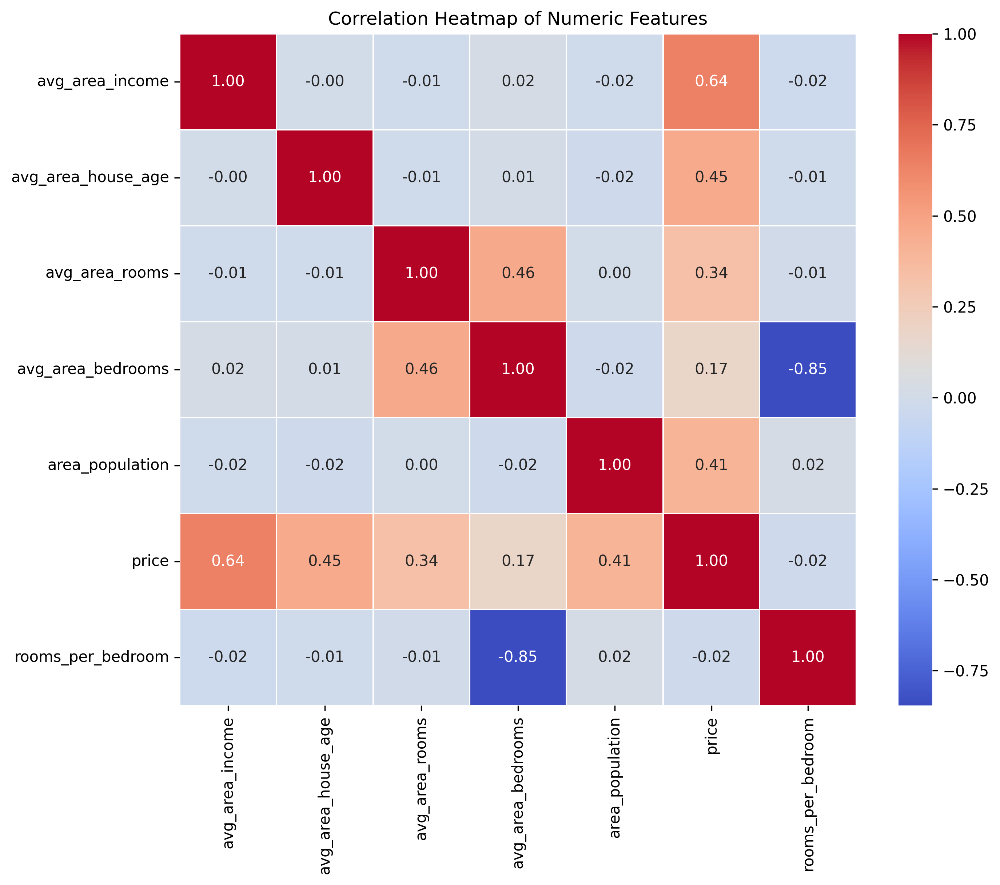
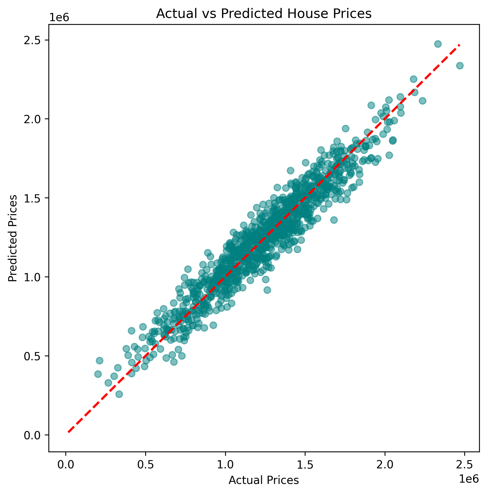

# House Price Prediction Using Machine Learning

## Problem Statement

A real-estate platform wants to provide sellers with instant, data-driven price estimates for houses based on area-level economic and housing indicators.

The objective is to build a Machine Learning regression model that predicts house prices and helps real-estate platforms provide fair and consistent price estimates instead of relying only on manual valuation.

## Dataset

- **Name:** USA Housing Dataset
- **Source:** Kaggle
- **Link:** https://www.kaggle.com/datasets/vedavyasv/usa-housing
- **Rows / Columns:** 5,000 rows and 7 columns
- **Target Variable:** Price

The dataset contains information about average area income, house age, number of rooms, number of bedrooms, area population and house prices.

The Address column was removed before model training.

## Tools Used

- Python
- Google Colab
- Pandas
- NumPy
- Matplotlib
- Seaborn
- Scikit-learn

## Workflow

1. Data Collection: Loaded the USA Housing dataset.
2. Data Cleaning: Checked missing values, renamed columns and removed the Address column.
3. Exploratory Data Analysis (EDA): Created a price distribution histogram, correlation heatmap, scatter plots and boxplot.
4. Feature Engineering: Created a rooms-per-bedroom feature and categorized population into Low, Medium and High groups.
5. Model Building: Linear Regression.
6. Evaluation: Evaluated the model using R² Score, Mean Absolute Error (MAE) and Root Mean Squared Error (RMSE).
7. Insights & Recommendations: Compared model prediction errors across different population categories and identified important features.

## Results

- **Model:** Linear Regression
- **Train-Test Split:** 80% Training and 20% Testing
- **R² Score:** 0.9180
- **MAE:** $80,881.07
- **RMSE:** $100,448.49

### Top Factors / Drivers

The three features with the largest absolute standardized model coefficients were:

1. Average Area Income: 231,741.57
2. Average Area House Age: 163,580.35
3. Area Population: 152,236.44

These features had the strongest model coefficients among the predictors used. Coefficients describe the model's learned relationships and do not establish causation.

## Population Density-Based Prediction Comparison

The model was evaluated across three population categories: Low, Medium and High.

The categories were created by dividing Area Population into three approximately equal-sized groups.

| Category | Samples | MAE | RMSE |
|---|---:|---:|---:|
| Low | 323 | $80,626.65 | $98,465.81 |
| Medium | 338 | $80,982.43 | $101,705.76 |
| High | 339 | $81,022.41 | $101,055.70 |

### Observations

- Low population areas had the lowest prediction error.
- Medium and High population areas had slightly higher prediction errors.
- The model showed relatively consistent prediction performance across all three categories.

Note: The dataset provides Area Population, not land area. Therefore, these are population-based categories rather than a direct measurement of geographical population density.

## Screenshots

### Exploratory Data Analysis

### Model Evaluation

## Future Improvements

- Experiment with additional regression algorithms such as Random Forest Regression.
- Perform hyperparameter tuning to improve model performance.
- Explore additional housing features to improve prediction accuracy.
- Deploy the trained model as a simple web application.

## Author

Diksha Yadav

LinkedIn: https://www.linkedin.com/in/diksha-yadav-a18083339/
